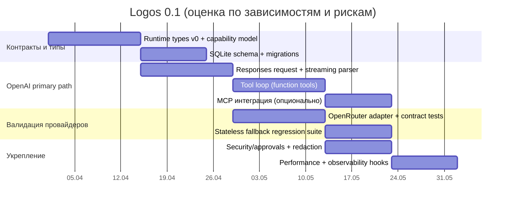

# Аналитический отчёт по документу Logos 0.1 Research Requirements

## Резюме

Предоставленный документ задаёт **формальные требования к исследовательскому отчёту**, который должен стать основанием для разработки Logos 0.1: нужно подтвердить факты об архитектуре и границах хоста/демона, провести аудит “поверхностей извлечения” из Codex (что можно сохранить, что оборачивать), сравнить семантику провайдеров (включая state/streaming/tools/structured outputs/reasoning), и отдельно разобрать возобновление сессии (resume/persistence) и инварианты tool-loop. Документ жёстко требует **не подгонять архитектуру ради “идеальной абстракции”**, а сохранять OpenAI Responses/Codex-путь как первоклассный и не “ломать” его ради унификации. fileciteturn2file0

Главный блокирующий фактор для полного выполнения части требований документа (в терминах самого документа) — **недоступность локальных файлов и репозитория**, на которые он ссылается (Chaemera/Logos docs и Codex source areas перечислены как пути в конкретной файловой структуре). Это делает невозможным “code-backed claims” с `path/symbol/lines` по реальному код-бейзу, как требует документ; такие пункты в отчёте объективно остаются `UNKNOWN` до предоставления файлов. fileciteturn2file0

По веб-части (в пределах доступных официальных источников) уже видно, что выбранные провайдеры **существенно расходятся** в ключевых местах, которые документ просит “не сглаживать”:  
- OpenAI Responses ориентирован на **stateful-by-default** и умеет “цепочки” через `previous_response_id` и/или долговечный объект `conversation` (Conversations API), плюс имеет встроенные инструменты и интеграцию с remote MCP servers. citeturn21search20turn23view2turn24view2  
- OpenRouter Responses API Beta — **stateless** фасад “как OpenAI”, и прямо говорит, что **server-side state не хранит**. citeturn22search9  
- Ollama поддерживает OpenAI `/v1/responses`, но **только non-stateful** (без `previous_response_id`/conversation). citeturn11search4turn20search15  
- LM Studio реализует `/v1/responses` с `previous_response_id` и отдельно имеет **native `/api/v1/chat`**, где statefulness и remote MCP доступны иначе, чем в OpenAI-совместимых endpoints. citeturn25view1turn25view2  
- Z.AI подчёркивает OpenAI-совместимость (base URL + key) и имеет собственные нативные гайды, включая **MCP server calling “на стороне провайдера”** (т.е. без MCP-клиента в приложении). citeturn19search2turn19search5turn16search0  
- Gemini поддерживает OpenAI-совместимость (для ряда endpoint’ов), но официально рекомендует при отсутствии зависимости от OpenAI SDK вызывать Gemini API напрямую; совместимый слой имеет “extra_body” для Google-специфичных фич (например, thinking). citeturn20search11turn29search14  

Вывод по рискам (оценка Звёздочки): **самый дешёвый и честный** валидационный второй адаптер для Logos 0.1 — OpenRouter (проверяет stateless fallback, нормализацию ошибок/лимитов, разнородность моделей), а третий “локальный” сценарий разумнее откладывать на 0.1+ либо включать как dev-only через LM Studio (потому что оно уже заявляет stateful `/v1/responses` и даёт сравнительные таблицы по endpoint’ам). citeturn22search9turn25view2  

## Извлечённые требования

### Функциональные требования

Документ требует, чтобы итоговый исследовательский отчёт (1) отвечал на вопросы “что переносим/оборачиваем” по модульным зонам Codex, (2) фиксировал архитектурные ограничения Chaemera/Logos как “host shell” и “daemon-first boundaries”, (3) включал матрицу семантики провайдеров по минимуму из семи режимов/провайдеров, (4) объяснял, какие данные нужны для resume/persistence, (5) описывал tool-loop и инварианты (IDs, ordering, injection), (6) вёл реестр рисков и unknowns, и (7) выдавал рекомендации решений для Logos 0.1. fileciteturn2file0

Особо выделено требование к **матрице семантики**: на каждого провайдера/режим нужно зафиксировать хотя бы: state model, streaming model, tool calling model, argument streaming, structured outputs, reasoning/thinking, context caching/continuation, built-in tools, image/file inputs, error+rate limit semantics. fileciteturn2file0

### Нефункциональные требования

Документ задаёт два “Hard Rules” (фактически архитектурных):  
- **Нельзя** рекомендовать архитектуру, которая “портит/переписывает” путь OpenAI Responses/Codex ради чистоты абстракций. fileciteturn2file0  
- **Нельзя** втискивать не-OpenAI провайдеров в OpenAI семантику, если возможности отличаются существенно; в отчёте это обязано быть явно отражено как различия/ограничения. fileciteturn2file0  

Также документ требует строгой политики доказательств: для code-backed claims обязательны `path/symbol/lines`, для external API claims — canonical doc URL + точная область фичи + тип источника, а при невозможности проверки — маркировка `UNKNOWN` и явное фиксирование конфликтов между источниками. fileciteturn2file0

## Недостающие и неоднозначные требования

В самом документе явно предполагается, что исследователь имеет доступ к внутренним Chaemera/Logos docs и к Codex source areas, но **в текущем вводе** эти материалы отсутствуют; следовательно, значимая часть вопросов Deliverable A/B/D/E (там, где нужно показать “где именно” в коде) остаётся не верифицируемой и должна быть помечена как `UNKNOWN` до предоставления файлов. fileciteturn2file0

Критичные недоопределённости, которые напрямую влияют на разработку, но в документе не заданы (и поэтому в планировании должны считаться “UNSPECIFIED”):

- **Целевая платформа** (десктоп/сервер/мобильные), хотя упоминается Tauri и “daemon-first” (это намекает на desktop + сервисный слой, но формально не зафиксировано). fileciteturn2file0  
- **Требования к хранению данных** (локально/в облаке/шифрование/retention), при том что OpenAI Responses имеет режимы “stateful” и также сценарии, где для stateless нужно включать `reasoning.encrypted_content` (например, при `store=false` или Zero Data Retention). citeturn23view0  
- **Перечень “major components” Logos 0.1** как продуктовых модулей (UI? agent runtime? store? инструменты?), хотя документ перечисляет deliverables, но не превращает их в WBS/plug-in границы. fileciteturn2file0  
- **Политика комплаенса** (GDPR/SOC2/локализация данных/аудит), хотя в источниках у ряда провайдеров есть собственные режимы логирования/retention и юридические условия (например, OpenRouter задаёт политику “не логировать промпты по умолчанию” и BYOK/ZDR режимы, а OpenAI имеет Services Agreement). citeturn17search5turn17search11turn22search9  

Если эти параметры не задать, то риск “архитектура красивая, но непригодная” резко вырастает — как раз то, против чего документ пытается застраховаться своими Hard Rules. fileciteturn2file0

## Карта зависимостей и источников

### Локальные файлы и артефакты, на которые ссылается документ

Следующие пути/файлы прямо перечислены как обязательный контекст, но **не доступны в текущем вводе** (поэтому считаются `UNAVAILABLE` и должны быть предоставлены для закрытия Deliverable A/B/D/E в формате `path/symbol/lines`). fileciteturn2file0

| Артефакт (как в документе) | Роль в требованиях документа | Статус доступа | Публичный эквивалент для скачивания |
|---|---|---|---|
| `docs-new/07-codex-logos-phase/README.md` | Подтверждение host/daemon ограничений | UNAVAILABLE | UNSPECIFIED (внутренний документ) |
| `docs-new/07-codex-logos-phase/2026-03-29-codex-logos-daemon-first-roadmap.md` | Дорожная карта daemon-first | UNAVAILABLE | UNSPECIFIED |
| `docs-new/07-codex-logos-phase/2026-03-29-chat-ui-post-xml-surface-inventory.md` | Инвентаризация UI surface | UNAVAILABLE | UNSPECIFIED |
| `docs-new/04-sprint-workflow/specs/2026-03-29-tauri-chat-runtime-phase-1-foundation-spec.md` | Ограничения runtime/IPC/Tauri | UNAVAILABLE | Частично: публичные материалы о Tauri и его архитектуре citeturn36search4turn36search0 |
| `docs-temp/*` (несколько файлов) | “adapter boundary”, “runtime types”, crate map | UNAVAILABLE | UNSPECIFIED |
| `AGENTS.md` | Общие правила | UNAVAILABLE | UNSPECIFIED |
| `C:\Work\codex-main\codex-rs\core\src\...` и `protocol\src\...` | Аудит Codex extraction surface, persistence, tool loop | UNAVAILABLE | Ближайшие публичные аналоги: официальные OpenAI API docs и публичный Codex CLI/пакет (как продукт), но это не замена исходникам codex-rs citeturn23view2turn21search20turn3search18 |

### Внешние сервисы, API/SDK, инструменты и стандарты

Ниже — зависимости, которые следуют из “External provider docs to research” и из требований к матрице семантики, а также “best practices” стандарты для streaming/JSON schema и базовый storage для resume. fileciteturn2file0

| Зависимость | Тип | Официальный источник/загрузка | Лицензия/условия | Последняя стабильная версия (по источнику) | Короткие заметки по интеграции |
|---|---|---|---|---|---|
| entity["company","OpenAI","ai company"] Responses API | Cloud API | Документация Responses + create response citeturn23view0turn21search20 | Для API — договорные условия (Services Agreement) citeturn17search11 | Версионирование API — по документации; SDK версии см. ниже | Поддерживает `conversation` и `previous_response_id` для stateful. Для stateless/ZDR может потребоваться `reasoning.encrypted_content` и явная передача items. citeturn23view0turn23view2 |
| OpenAI Python SDK `openai` | SDK (PyPI) | PyPI страница citeturn4view0 | Apache-2.0 citeturn4view0 | 2.30.0 (релиз 25 Mar 2026) citeturn4view0 | Пригоден как reference-реализация моделей событий Responses+SSE; подчёркивает best practice не хранить API key в коде. citeturn4view0 |
| OpenAI JS/TS SDK `openai` | SDK (npm/GitHub) | Репозиторий citeturn8view0 | Apache-2.0 citeturn8view0 | 6.33.0 (по npm сниппету) citeturn6search14turn6search18 | Встроенная поддержка streaming через SSE и подсказки по опасности использования ключа в браузере. citeturn8view0 |
| OpenAI Java SDK `com.openai:openai-java` | SDK (Maven Central) | Maven Central/ Sonatype citeturn9search0turn9search4 | Apache-2.0 citeturn9search0 | 4.30.0 (Mar 26 2026) citeturn9search4turn9search0 | Полезно как reference по объектной модели и поддержке Responses в typed-форме. citeturn9search0 |
| OpenAI .NET SDK `OpenAI` | SDK (NuGet/GitHub) | NuGet citeturn10view0 | MIT (репозиторий) citeturn9search7 | 2.9.1 citeturn10view0 | Документация NuGet прямо описывает `Endpoint` для OpenAI-compatible API (прокси/локальные LLM). citeturn10view0 |
| entity["company","OpenRouter","ai routing platform"] Responses API Beta | Cloud API (OpenAI-compatible facade) | Overview: stateless drop-in replacement citeturn22search9 | Terms of Service citeturn17search0 | Beta (breaking changes возможны) citeturn22search1turn22search9 | Ключевая проверка для Logos: “stateless fallback” и нормализация параметров/ошибок. citeturn22search6turn22search3 |
| OpenRouter Python SDK `openrouter` | SDK (PyPI) | PyPI citeturn27view0 | Apache-2.0 citeturn27view0 | 0.8.0 (Mar 27 2026) citeturn27view0 | В документации признаёт beta-maturity и рекомендует pin версии, что важно для воспроизводимости. citeturn27view0 |
| OpenRouter TS SDK `@openrouter/sdk` | SDK (npm) | npm сниппет citeturn26search1 | Apache-2.0 citeturn26search1turn26search3 | 0.9.11 citeturn26search1 | Используется, если интеграция Logos/UI делается в TS-слое; иначе — REST напрямую. |
| entity["company","Anthropic","ai company"] Messages API + Tool Use | Cloud API | Tool use overview citeturn18search9 | Коммерческие условия (для SDK/продуктов) зависят от канала; в документации SDK это явно отмечается citeturn17search18 | API версионируется заголовками/доками (конкретика зависит от endpoint) | Важное отличие: “tool_use/tool_result blocks” и content-block модель; отдельная модель caching — `cache_control`. citeturn18search9turn18search1 |
| Anthropic Python SDK `anthropic` | SDK (PyPI) | PyPI citeturn28search0 | (не показано в сниппете PyPI в текущем источнике → UNSPECIFIED) | 0.86.0 (Mar 18 2026) citeturn28search0 | Для streaming есть отдельная страница “Streaming Messages”. citeturn18search0 |
| Anthropic TS SDK `@anthropic-ai/sdk` | SDK (npm/GitHub) | npm сниппет citeturn28search1 | MIT citeturn28search2 | 0.80.0 citeturn28search1 | Полезен как reference-реализация content-block streaming и tool_use. citeturn18search0turn18search9 |
| entity["company","Google","technology company"] Gemini API OpenAI compatibility | Cloud API | OpenAI compatibility doc citeturn29search14turn20search11 | Terms of Service обновляются у Google (упоминание в docs) citeturn29search3turn29search7 | Endpoint в docs (`v1beta/openai/...`) | Совместимость поддерживает streaming и Google-специфичные поля через `extra_body.google.thinking_config`. citeturn19search15turn29search14 |
| Google GenAI Python SDK `google-genai` | SDK (PyPI) | PyPI citeturn30view0 | Apache-2.0 citeturn30view0 | 1.69.0 (Mar 28 2026) citeturn30view0 | Рекомендуется как “GA production-ready”; поддерживает Developer API и Vertex AI; есть опции выбора API версии (`v1`, `v1alpha`). citeturn30view0turn29search3 |
| entity["company","Z.AI","ai platform"] API + OpenAI-compat | Cloud API | API introduction (endpoints, Bearer auth) citeturn19search5 | Terms of Use citeturn16search0 | Версия API не дана как semver → UNSPECIFIED | Есть отдельные endpoints (`/api/paas/v4` и `/api/coding/paas/v4`), error codes, caching и MCP server calling как capability. citeturn19search5turn16search2turn19search13turn19search2 |
| Z.AI Python SDK `zai-sdk` | SDK (PyPI) | PyPI citeturn34view0 | MIT citeturn34view0 | 0.2.2 (Feb 2 2026) citeturn34view0 | Внутри описывает streaming, tool calling, multimodal, web_search tool; полезно как “native SDK docs second”. citeturn34view0turn16search15 |
| Z.AI Java SDK `ai.z.openapi:zai-sdk` | SDK (Maven) | mvnrepository (версии) citeturn35view0 | MIT citeturn35view0 | 0.3.3 (Feb 02 2026) citeturn35view0 | Удобно как reference по SSE/HTTP клиентам (видно по POM для некоторых версий). citeturn35view1 |
| entity["organization","Ollama","local llm runtime"] | Local runtime + OpenAI-compat API | GitHub repo (download/install, license, release) citeturn12view0 | MIT citeturn12view0 | v0.19.0 (Mar 27 2026) citeturn12view0 | `/v1/responses` есть, но **только non-stateful**; годится как тест “stateless provider” в dev. citeturn11search4turn20search15 |
| Ollama OpenAI compatibility docs | Документация | `/v1/responses` note (v0.13.3+) citeturn11search4 | Документация | — | Явно фиксирует отсутствие `previous_response_id`/conversation. citeturn11search4 |
| entity["company","LM Studio","local llm app"] | Local runtime + OpenAI/Anthropic-compat + native API | Changelog (версия 0.4.7) citeturn15view0 | Terms of Use (download page) citeturn13view0 | 0.4.7 (Mar 18 2026) citeturn15view0 | Имеет native `/api/v1/*` и сравнение endpoint’ов; `/v1/responses` поддерживает `previous_response_id`. citeturn25view2turn25view1turn25view0 |
| Model Context Protocol (MCP) | Протокол/экосистема | OpenAI guide про remote MCP servers + ссылка на spec citeturn24view2 | Зависит от SDK (см. ниже) | — | В OpenAI Responses MCP идёт как built-in tool `mcp`, с рисками third-party servers и рекомендацией выбирать “официальные сервера провайдеров”. citeturn24view2 |
| MCP TypeScript SDK | SDK (GitHub) | repo citeturn28search14 | Apache-2.0 для новых вкладов + MIT для части кода citeturn28search14 | Версия не дана в сниппете → UNSPECIFIED | Для Logos важно, если MCP-клиент/серверная часть реализуется в JS/TS; иначе использовать как reference spec поведения. citeturn24view2turn28search14 |
| SSE (Server-Sent Events) | Web-стандарт | Streaming в OpenAI/LM Studio описан как SSE citeturn24view0turn25view1 | Стандарт | — | Требует корректного воспроизведения event stream и типов событий (особенно function-call args delta). citeturn24view0 |
| JSON Schema 2020-12 | Стандарт схем | json-schema.org spec citeturn36search7turn36search3 | (спецификация) | 2020-12 (current) citeturn36search7 | OpenAI Structured Outputs и OpenRouter Structured Outputs опираются на JSON Schema; в tool calling параметры тоже schema. citeturn21search13turn22search2turn21search2 |
| SQLite | База данных (для resume/persistence) | Официальный сайт (public domain; релиз) citeturn36search18turn36search2 | Public domain citeturn36search2 | 3.51.3 (Mar 13 2026) citeturn36search18 | Практичный default для локального durable журнала tool-loop/сессий; комплаенс проще, чем у “самодельного бинарного формата”. citeturn36search2 |

## Матрица семантики провайдеров

Документ запрещает “замазывать” различия ради чистой абстракции; поэтому матрица ниже **явно фиксирует несовместимости** и те места, где требуется fallback или отдельная ветка логики. fileciteturn2file0

| Провайдер/режим | State/continuation | Streaming | Tool calling | Structured outputs | Reasoning/thinking | Built-in tools / MCP | Мультимодальность | Errors/rate limits |
|---|---|---|---|---|---|---|---|---|
| OpenAI Responses | Stateful: `conversation` (durable object) и/или `previous_response_id`; параметр `store` управляет сохранением; для stateless возможен режим с `reasoning.encrypted_content` citeturn23view2turn23view0turn21search0 | Семантические события (typed), SSE citeturn24view0 | Function calling (JSON schema, strict по умолчанию) + hosted tools citeturn23view0turn21search2 | Structured Outputs (schema adherence) рекомендованы вместо JSON mode citeturn20search12turn21search13 | `reasoning.effort`, reasoning items, перенос через `previous_response_id` citeturn21search4turn21search0 | Built-in tools (web/file/code interpreter/image gen) + remote MCP/connectors citeturn23view0turn24view1turn24view2 | Text/image/file inputs заявлены в create response citeturn23view0 | Документация error codes + rate limits citeturn21search14turn21search3 |
| OpenRouter Responses API Beta | Явно stateless, каждый запрос независим, state не хранится server-side citeturn22search9 | SSE streaming описан в API reference citeturn22search17 | Tool calling для Responses Beta есть (в т.ч. parallel) citeturn22search1 | Structured outputs (JSON Schema) для совместимых моделей citeturn22search2 | Отдельная конфигурация reasoning tokens/effort; требование сохранять reasoning_details при продолжении диалога (client-side) citeturn22search0turn22search13 | Может иметь web search integration (в рамках фасада), но это не OpenAI hosted tools 1:1 → требуется явное различение в архитектуре citeturn22search9 | Зависит от провайдера/модели; OpenRouter нормализует, но может игнорировать неподдерживаемые параметры citeturn22search6 | Error handling документирован (400/401/402/429/5xx) citeturn22search3turn22search7 |
| Anthropic Messages API | Continuation — через передачу messages/content blocks; есть prompt caching через `cache_control` citeturn18search1 | Streaming Messages (event model) citeturn18search0 | Tool use: tool_use/tool_result, “agentic loop” на стороне клиента или server tools citeturn18search9 | Structured outputs поддержка зависит от модели (поле `structured_outputs`) citeturn18search6 | Extended thinking имеет модельно-зависимые особенности; есть русская документация citeturn18search4 | Есть server tools (у Anthropic) и client tools; MCP тесно фигурирует в агентных SDK, но это отдельная экосистема citeturn18search2turn17search18 | Поддержка PDF/vision развивается; в release notes упоминаются URL source blocks для images/PDF citeturn18search10 | Требует отдельной нормализации ошибок; в текущих источниках нет компактной таблицы → PARTIALLY SPECIFIED |
| Gemini OpenAI compatibility | Совместимый слой; Google рекомендует использовать нативный Gemini API напрямую, если не нужна совместимость citeturn29search14turn20search11 | Streaming поддерживается citeturn19search15 | Через OpenAI-compatible chat/completions; Google-специфичные параметры через `extra_body.google...` citeturn19search15 | Зависит от endpoint; формально в doc фокус на совместимости, а не на “strict schema” как у OpenAI → требует валидации в прототипе | Thinking конфигурируется через Google-specific поля в compatible слое citeturn19search15 | Встроенные инструменты/оркестрация — в нативных SDK/возможностях; для совместимого слоя это не 1:1 с OpenAI hosted tools → REQUIRED PROTOTYPE | Мультимодальность и модельные режимы в Gemini API есть, но конкретные пересечения с OpenAI-совм. слоем должны быть подтверждены отдельным тестом citeturn29search7turn29search23 | Ошибки/лимиты — по docs Google; в текущем пакете источников нет единой компактной таблицы → PARTIALLY SPECIFIED |
| Z.AI OpenAI-compatible + native | Базовые endpoint’ы `/api/paas/v4`, отдельный coding endpoint; заявлены multi-turn и context caching citeturn19search5turn19search13 | Streaming заявлен и в SDK, и в API docs citeturn19search14turn34view0 | Function calling есть; плюс отдельный “tool_stream” сценарий в гайдах citeturn31search12turn31search6 | В модельных гайдах заявлен structured output (JSON) citeturn20search9 | Thinking mode заявлен для моделей (GLM-5 и др.) citeturn20search6 | Уникально: **MCP server calling** как capability “в chat/completions”, без MCP-клиента в приложении citeturn19search2 | В chat completion заявлена поддержка text/images/audio/video/file citeturn19search14 | Есть таблица business error codes (rate limit и др.) citeturn16search2 |
| Ollama OpenAI compatibility | `/v1/responses` есть, но **только non-stateful**, нет `previous_response_id`/conversation citeturn11search4turn20search15 | Streaming зависит от endpoint; для OpenAI-совм. `/v1/responses` подразумевает SSE (как обычно) → практическая проверка нужна | Tool calling зависит от OpenAI-совм. реализации/модели; doc фокусируется на ограничениях stateful citeturn11search4 | Ограничения по response_format для ряда типов (в doc есть списки поддерживаемых полей) citeturn11search4 | Reasoning зависит от модели/инструментов Ollama; в явных источниках для `/v1/responses` — частично | Нет OpenAI hosted tools; это локальный runtime; интеграции (например, “launch claude/codex”) есть как отдельные сценарии citeturn12view0 | Определяется моделью; Ollama как runtime это поддерживает на уровне модели | Как локальный runtime — лимиты и ошибки иные, чем у облачных провайдеров; нужен отдельный error adapter |
| LM Studio OpenAI-compatible + native | `/v1/responses` stateful via `previous_response_id`; native `/api/v1/chat` тоже stateful citeturn25view1turn25view2 | SSE для `/v1/responses` при `stream:true`; native API имеет свои события citeturn25view1turn25view2 | Custom tools и Remote MCP — поддерживаются в `/v1/responses` (opt-in) citeturn25view1 | Зависит от модели; LM Studio фиксит parsing ошибок tool calls в релизах citeturn15view0 | Reasoning support оговорён для `reasoning.effort` (например, gpt-oss) citeturn25view1turn15view0 | В сравнении endpoint’ов: Remote MCPs доступны для native `/api/v1/chat` и `/v1/responses`, но не для `/v1/chat/completions` и `/v1/messages` citeturn25view2 | Зависит от модели; релизы упоминают vision-фиксы citeturn15view0 | Ошибки совместимости чинятся релизами (видны багфиксы вокруг “timeline invariant violated”) citeturn15view0 |

### Архитектурная диаграмма “как минимум” для Logos 0.1

```mermaid
flowchart LR
  UI[Chaemera Host/UI Shell] -->|IPC/Transport| D[Logos Daemon Runtime]

  subgraph D[Daemon Runtime]
    R[Request Router]
    OAI[OpenAI Adapter (primary)]
    ALT[Alt Provider Adapter(s)]
    TOOL[Tool Loop Runtime]
    STORE[(Resume/Persistence Store)]
    SCHEMA[Schema/Output Validation]
  end

  R --> OAI
  R --> ALT
  OAI --> TOOL
  ALT --> TOOL
  TOOL --> STORE
  OAI --> SCHEMA
  ALT --> SCHEMA

  subgraph Providers
    P1[OpenAI Responses]
    P2[OpenRouter Responses (stateless)]
    P3[Anthropic Messages]
    P4[Gemini OpenAI-compat / native]
    P5[Z.AI OpenAI-compat / native + MCP server calling]
    P6[Ollama /v1/responses (non-stateful)]
    P7[LM Studio /v1/responses + /api/v1/chat]
  end

  OAI --> P1
  ALT --> P2
  ALT --> P3
  ALT --> P4
  ALT --> P5
  ALT --> P6
  ALT --> P7
```

Диаграмма отражает главный смысл Hard Rules: **адаптеры не должны “переписать” OpenAI ветку**, а должны существовать как дополнительные ветви с честной фиксацией отличий по state/tools/streaming. fileciteturn2file0

## Сравнение альтернатив по ключевым компонентам

Ниже — набор таблиц “минимум 3 альтернативы” для критически больших частей, которые прямо вытекают из документа (provider integration, state/resume, tool integration).

### Компонент “Responses-совместимый слой” как точка интеграции

| Название | Плюсы | Минусы | Лицензия | Ссылка | Зрелость |
|---|---|---|---|---|---|
| OpenAI Responses API | Максимальная полнота фич: stateful, built-in tools, MCP/connectors, typed streaming events | Vendor lock-in; комплаенс/retention требуют отдельной политики `store`/ZDR | Договорные условия API (Services Agreement) citeturn17search11 | citeturn23view0turn24view2 | Высокая |
| OpenRouter Responses API Beta | Drop-in OpenAI-совместимость; stateless упрощает локальную воспроизводимость; единый доступ к множеству моделей | Beta и **stateless** (нет серверного state); параметры могут игнорироваться по модели | Terms of Service citeturn17search0 | citeturn22search9turn22search6 | Средняя (Beta) |
| LM Studio `POST /v1/responses` | Локально; поддерживает `previous_response_id`; есть Remote MCP (opt-in) | Условия использования (не open-source); поведение зависит от локальных моделей/шаблонов | Terms of Use citeturn13view0 | citeturn25view0turn25view1 | Средняя/высокая (быстро развивается) |
| Ollama `POST /v1/responses` | Локально; open-source runtime; простая установка (скрипты/докер) | Только non-stateful: нет `previous_response_id`/conversation; совместимость ограничена | MIT citeturn12view0 | citeturn11search4turn12view0 | Высокая (runtime), но совместимость Responses — ограниченная |

### Компонент “Conversation state / resume стратегия”

| Название | Плюсы | Минусы | Лицензия | Ссылка | Зрелость |
|---|---|---|---|---|---|
| OpenAI Conversations API (`conversation`) | Долговечный ID, удобен для resume “между устройствами/сессиями” | Привязка к OpenAI; требует `store`/политик хранения | Договорные условия API citeturn17search11 | citeturn23view2 | Высокая |
| OpenAI `previous_response_id` chaining | Простой способ stateful диалога “цепочкой”; меньше сущностей | В docs есть нюансы: инструкции не обязательно “переносятся” автоматически, требуется дисциплина input/instructions | Договорные условия API citeturn17search11 | citeturn23view2turn21search1turn21search17 | Высокая |
| Полностью stateless (client-managed items) | Работает с любым провайдером (включая OpenRouter/Ollama); идемпотентность и воспроизводимость выше | Нужен внутренний “record model” и строгий журнал tool-loop; рост payload/стоимости | Зависит от реализации | Опора: stateless природа OpenRouter citeturn22search9 и Ollama citeturn11search4; для OpenAI есть подсказка про stateless reasoning items citeturn23view0turn21search0 | Средняя (как инженерная дисциплина) |

### Компонент “Tool loop и расширение через MCP/инструменты”

| Название | Плюсы | Минусы | Лицензия | Ссылка | Зрелость |
|---|---|---|---|---|---|
| OpenAI built-in tools (web/file/code interpreter/image gen) | Минимум кода в приложении; типизированные элементы в Responses | Привязка к OpenAI; комплаенс и разрешения на tool calls нужно контролировать | Договорные условия | citeturn24view1turn23view0 | Высокая |
| OpenAI remote MCP servers / connectors | Стандартизированный способ подключать внешние сервисы; режим approvals | Security риск third-party MCP; best practice — выбирать официально хостимые сервера (например, Stripe на домене провайдера) | Зависит от MCP сервера; OpenAI предупреждает про риски | citeturn24view2 | Средняя/высокая (экосистема растёт) |
| Z.AI MCP server calling (server-side) | Модель сама подключается к MCP серверам “на стороне провайдера” без MCP клиента в приложении | Это **другая модель доверия**: вы делегируете tool execution провайдеру; несовместимо 1:1 с client-side tool loop | Terms of Use провайдера | citeturn19search2turn16search0 | Средняя |
| “Чистый” client-side tool loop + function calling | Полный контроль над секретами/PII; можно поддержать любой провайдер (при наличии tool calls) | Дорого в инженерии: нужен строгий журнал, инварианты, replay; parsing tool args в streaming сложен | Зависит от реализации | Основа: OpenAI function calling + streaming events citeturn21search2turn24view0; риск tool call parsing виден даже у LM Studio (фиксы) citeturn15view0 | Средняя |

## Безопасность, приватность, производительность и комплаенс

### Безопасность и контроль доступа

Ключевой риск, который документ косвенно подразумевает (через focus на tool-loop, approvals и MCP), — **расширение модели внешними инструментами**. OpenAI прямо предупреждает, что remote MCP servers не верифицированы, могут позволять доступ/отправку данных и выполнение действий, и рекомендует предпочитать “официальные” MCP сервера, хостимые владельцами сервисов. citeturn24view2

Практическое следствие для Logos 0.1: независимо от выбранного провайдера, нужен единый слой политики:
- allowlist MCP server URLs/labels,
- режим “explicit approval required” для опасных tool calls,
- раздельное хранение секретов (API keys/OAuth tokens) от журналов диалога,
- аудит логов tool execution с минимизацией содержимого (PII/секреты).  
Эти меры логически следуют из рисковой модели remote MCP и из того, что OpenRouter и провайдеры могут иметь разные политики логирования/retention. citeturn24view2turn17search9turn17search5

### Приватность и хранение данных

OpenAI Responses включает явные механизмы хранения и переноса контекста (включая `store`, `conversation`, `previous_response_id`) и даже опцию `reasoning.encrypted_content` для сценариев stateless/ZDR. Это означает: “resume/persistence” нельзя проектировать в вакууме — нужно заранее решить, где каноническая история: у провайдера (stateful) или у клиента (stateless journal). citeturn23view0turn23view2

OpenRouter заявляет, что **не хранит prompts/responses по умолчанию**, если пользователь явно не включил логирование; при этом отмечает, что у downstream providers могут быть собственные retention политики. Это усиливает требование документа “не замазывать различия”: один и тот же текст может жить в разных системах в зависимости от маршрутизации. citeturn17search5turn17search9

Z.AI явно формулирует роли Data Controller/Processor в privacy policy и указывает на обязанности по Data Protection Laws, что тоже требует от Logos явного слоя комплаенса (особенно если Logos будет продуктом для третьих лиц). citeturn16search3turn16search0

### Производительность, устойчивость и наблюдаемость

Для streaming и tool calling узкое место почти всегда в “event correctness”: OpenAI описывает поток как семантические typed events, а LM Studio прямо упоминает баги вокруг “timeline invariant violated” в `/v1/responses` и чинит parsing tool calls в релизах. Это значит: даже при OpenAI-совместимости потребуется **строгий валидатор инвариантов** (order, completeness, matching tool_call_id ↔ tool_result) и хорошие fallback-пути (повтор, reparsing, переключение на non-streaming). citeturn24view0turn15view0

Для локального состояния/журнала самый практичный базис — SQLite (public domain) с явным schema/миграциями; это снижает риск “самодельного формата” и упрощает форензику при баге resume. citeturn36search2turn36search18

## Оценка усилий, рисков и чеклист поставки

### Варианты реализации Logos 0.1

**Опция A: OpenAI-first + OpenRouter как валидационный второй адаптер**  
- Усилия: средние  
- Риск: низкий/средний  
- Почему: сохраняется “канонический” путь OpenAI Responses (как требует документ), а OpenRouter сразу проверяет stateless fallback, игнорирование неподдерживаемых параметров и нормализацию ошибок. citeturn22search9turn22search6turn23view2  
- Митигации: фиксировать в runtime type-system различие “stateful vs stateless”; автоматические контракт-тесты на матрицу параметров/ошибок.

**Опция B: OpenAI-first + LM Studio как dev-only локальный провайдер (для прототипов tool-loop/resume)**  
- Усилия: средние/высокие  
- Риск: средний  
- Почему: LM Studio даёт stateful `/v1/responses` и таблицу различий endpoint’ов; можно быстро тестировать MCP/streaming без затрат на облако. citeturn25view2turn15view0  
- Риски: нестабильность совместимости, зависимость от локальных моделей и prompt templates; лицензия/terms важны для распространения. citeturn13view0turn15view0  
- Митигации: “dev-only flag”; контракт-тесты на invariants; чёткое разделение native API и OpenAI-compat API.

**Опция C: Мульти-провайдер сразу (OpenAI + Anthropic + Gemini + Z.AI + локальные)**  
- Усилия: высокие  
- Риск: высокий  
- Почему: семантические различия по tools/state/thinking слишком велики; документ прямо запрещает “насильную унификацию”, значит придётся поддерживать много веток. fileciteturn2file0  
- Митигации: ограничить поверхность Logos 0.1 (например, только text + function tools без hosted tools), “capability discovery” и явная деградация фич по провайдеру.

### Приоритизированный чеклист deliverables для разработки

Ниже — список артефактов, который превращает требования документа в план поставки (в порядке важности). Пункты, требующие недоступных файлов, помечены как BLOCKED до предоставления. fileciteturn2file0

1) **Capability & semantics contract для Logos Runtime Types (v0)**: типы, которые не содержат OpenAI wire types как “канон”, но позволяют lossless хранить то, что нужно для resume и tool-loop (включая tool call IDs и streaming deltas). Основание: требование “wire types must not leak” + матрица семантики. fileciteturn2file0

2) **OpenAI Responses первичный путь**: реализация request/stream parser по официальным событиям, и минимальный tool-loop, совместимый с function calling + (опционально) remote MCP. Основание: streaming events + tools/MCP docs. citeturn24view0turn24view1turn24view2turn21search2

3) **Stateless fallback слой**: режим, где на вход/выход сериализуется журнал items (включая reasoning/structured outputs) без reliance на server-side state. Основание: OpenRouter stateless и Ollama non-stateful. citeturn22search9turn11search4turn23view0

4) **Валидационный адаптер OpenRouter**: минимальный набор тестов “параметр → ожидаемое поведение” + error/rate-limit mapping. Основание: OpenRouter параметы/ошибки/лимиты. citeturn22search6turn22search3turn22search7

5) **Resume/persistence store**: SQLite schema для сессий, tool-loop журналов, связи между request ↔ response ↔ tool_result, стратегия миграций. Основание: документ требует resume findings; SQLite public domain и свежая версия. citeturn36search2turn36search18

6) **Security policy слой для tools/MCP**: allowlist, approvals, redaction, секреты отдельно от логов. Основание: риски remote MCP servers + разная политика логирования провайдеров. citeturn24view2turn17search5turn17search9

7) **BLOCKED: Codex extraction surface audit (path/symbol/lines)**: без предоставления перечисленных файлов Codex/Chaemera невозможно закрыть требования Deliverable A/B/D/E “по коду”. fileciteturn2file0

### Минимальный таймлайн (оценка)



Эта оценка намеренно не притворяется “точной”: документ не задаёт объём UI/хостовой части и не даёт доступ к реальному код-бейзу, поэтому календарь — ориентир по **техническим зависимостям**, а не обещание. fileciteturn2file0